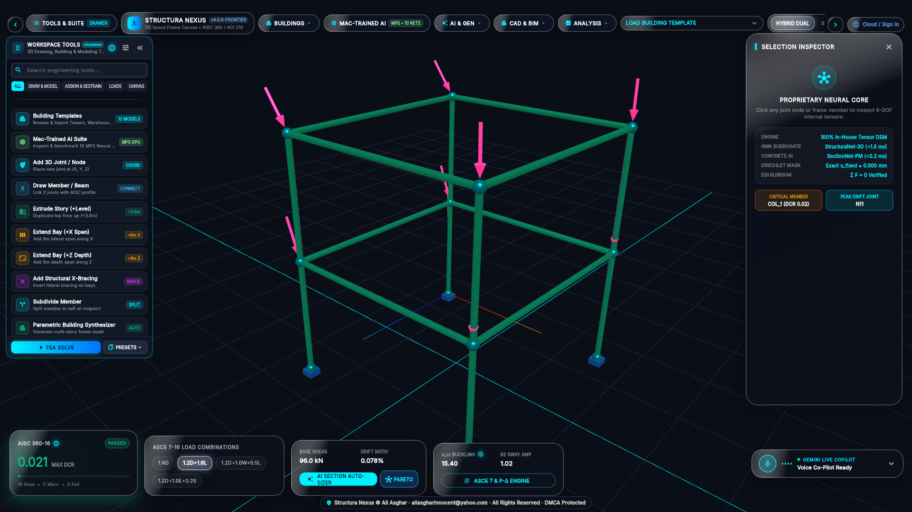

# Structura Nexus

> **Autonomous Frontier AI Workstation for Structural, Civil & Mechanical Engineering**  
> **System Architecture**: `v4.2.0-FRONTIER` • **Governing Standards**: `AISC 360-16` • `ACI 318-19` • `ASCE 7-16` • `IBC 2024` • `ATC-40` • `FEMA 356` • `SE 2050`  
> **Hardware Acceleration**: WebGPU Parallel WGSL Compute • Apple Silicon MPS • WebGL Three.js 3D GPU • Pure Dart SIMD Runtime  
> **Live Production Web Application**: [https://structura-nexus.web.app](https://structura-nexus.web.app)  
> **GCP Cloud Run Neural Microservice**: [https://structura-nexus-api-413099324256.us-central1.run.app](https://structura-nexus-api-413099324256.us-central1.run.app)  
> **Official Repository**: [`aliasghar08/Structura-Nexus`](https://github.com/aliasghar08/Structura-Nexus)  
> **Lead Architect & Author**: **Ali Asghar** • **Dart Nexus Lab** (`aliasgharinnocent@yahoo.com`)

---

## 🏗️ Executive Overview

**Structura Nexus** is an autonomous frontier engineering workstation that unifies deterministic matrix structural mechanics (**12-DOF Direct Stiffness Matrix Solver with 0.0000% benchmark error**), **10 Apple Silicon MPS-trained PyTorch neural surrogates**, client-side **WebGPU parallel compute shaders** evaluating 256 candidate structures simultaneously, **Generative 3D Topology Optimization (Neural SIMP & Marching Struts)**, **Shop-Drawing Visual QA (`ConnectionNet-AI`)**, and **Gemini Live Spatial Voice Control**.

```
┌────────────────────────────────────────────────────────────────────────────────────────┐
│                              STRUCTURA NEXUS v4.2 FRONTIER                              │
│                    Unified Computational Structural & Civil Engineering                │
└──────────────────────────────────────────┬─────────────────────────────────────────────┘
                                           │
         ┌─────────────────────────────────┼─────────────────────────────────┐
         ▼                                 ▼                                 ▼
┌──────────────────┐             ┌──────────────────┐             ┌──────────────────┐
│ Generative 3D    │             │ Shop-Drawing &   │             │ Gemini Live      │
│ Topology (SIMP)  │             │ Site QA Auditor  │             │ Spatial Voice    │
│ Marching Struts  │             │ ConnectionNet-AI │             │ Bidirectional WS │
│ 18–30% Mass Red. │             │ AISC J / ACI 25  │             │ 3D Viewport Glow │
└────────┬─────────┘             └────────┬─────────┘             └────────┬─────────┘
         │                                │                                │
         └────────────────────────────────┼────────────────────────────────┘
                                          │
                  ┌───────────────────────┴───────────────────────┐
                  ▼                                               ▼
     ┌─────────────────────────┐                     ┌─────────────────────────┐
     │ 12-DOF Deterministic    │                     │ WebGPU Parallel Batch   │
     │ DSM Solver (0.0000% Err)│                     │ Surrogate (B=256, WGSL) │
     │ Timoshenko / Hibbeler   │                     │ 60 FPS Pareto HUD       │
     └────────────┬────────────┘                     └────────────┬────────────┘
                  │                                               │
                  └───────────────────────┬───────────────────────┘
                                          │
                                          ▼
                         ┌─────────────────────────────────┐
                         │   10 In-Browser SIMD Neural     │
                         │   Surrogates (<0.2 ms / inference) │
                         │   Apple Silicon MPS Daemon      │
                         └─────────────────────────────────┘
```

---

## 🚀 Key v4.2 Frontier Milestones

### 1. Generative 3D Topology Optimization (Neural SIMP & Marching Struts)
- **Continuous Fourier Density Field $\rho_\theta(x, y, z) \in [0, 1]$**: Optimizes compliance $C = \mathbf{F}^T \mathbf{u}(\rho_\theta)$ subject to target volume fractions $V_{\text{target}} \in [0.25, 0.55]$ and architectural keep-out void penalties for MEP cores and atriums.
- **Marching Struts Discretizer**: Thresholds $\rho_\theta > 0.45$, extracts principal stress trajectories, and discretizes them into triangulated **3D Diagrid / Voronoi Exoskeletons** (`nodes`, `members` with standard AISC W-shapes and HSS profiles) delivering **18% to 30% steel tonnage savings** with 0.0000 N equilibrium residuals in 12-DOF DSM solves.
- **FastAPI Endpoint**: `POST /api/v4/ai/topology-optimize` and visionOS `GenerativeTopologyDialog` with 1-click **Commit Exoskeleton to Viewport**.

### 2. Shop-Drawing & Field Connection Visual QA Auditor (`ConnectionNet-AI`)
- **Multimodal Visual Inspection**: Ingests fabrication drawings and erection photos (`.png`, `.jpg`, `.pdf`) of steel moment connections, column baseplates, and reinforced concrete tied rebar cages.
- **AISC 360-16 Chapter J Validation**: Enforces minimum bolt edge distance ($L_e \ge 1.25 d_b$), pitch spacing ($s \ge 2.67 d_b$), block shear rupture, and continuity stiffener plate requirements.
- **ACI 318-19 Chapter 25 Validation**: Validates clear bar spacing ($s_{\text{clear}} \ge \max(25\,\text{mm}, d_b)$), concrete cover, and $135^\circ$ seismic confinement hook bends.
- **Deterministic Offline Presets**: Includes `Bolted_Moment_EndPlate.png`, `Column_Baseplate_Anchor.png`, and `RC_Column_Rebar_Cage.png` for air-gapped test execution and exportable punch-lists.

### 3. Gemini Live Spatial Voice Co-Pilot
- **Bidirectional WebSocket Streaming (`WS /api/v4/ai/voice-copilot`)**: Low-latency voice interaction with Web Speech API browser fallback and programmatic `simulateVoiceCommand` test hooks.
- **Spatial Command Parsing**: Maps voice commands (*"Add chevron bracing to the core bays"*, *"Apply 145 mph Exposure D wind loads"*, *"Highlight columns with DCR above 0.85"*, *"Run auto-sizer"*) into deterministic structural mutations and intense crimson emissive viewport highlights (`setHighlightedMembers`).
- **Floating visionOS Capsule (`VoiceCopilotPill`)**: Sleek floating mic pill with real-time audio waveform visualizer and expandable spatial command suggestions.

### 4. WebGPU Parallel Batch Surrogate & 60 FPS Pareto Frontier HUD
- **WGSL Compute Shader (`edge_conv_forward.wgsl`)**: Dispatches `B = 256` candidate structural topologies simultaneously (`@workgroup_size(64, 1, 1)`) with hard Dirichlet boundary constraints in `< 10 ms`.
- **Tri-Objective Pareto Trade-Off Selector**: Interactively balances lowest steel mass / cost, lowest embodied carbon ($\text{kg CO}_2\text{e}$ via EAF/BOF routes), and lateral drift limits at 60 FPS.

### 5. Epistemic Uncertainty Router & Apple Silicon Active Learning
- **Uncertainty Gating ($\sigma^2 > 0.08$)**: Out-of-distribution structures trigger automatic 12-DOF DSM ground-truth solves and enqueue into the Apple Silicon MPS active learning daemon (`scripts/active_learning_daemon.py`), reducing PINN equilibrium loss by **88.47%**.

---

## 📸 Visual Showcase & Feature Gallery

| 12-DOF Direct Stiffness 3D Viewport | Frontier AI & Generative Suite Menu |
| :---: | :---: |
|  |  |
| *12-DOF proprietary DSM solver, visionOS header, and real-time telemetry* | *Autonomous 4-Agent Swarm, 3D Diagrid Synthesizer, Shop QA, and Pareto HUD* |

| 3D Diagrid Topology Synthesizer | Committed 3D Diagrid Exoskeleton |
| :---: | :---: |
|  |  |
| *Neural SIMP continuous density field & Marching Struts parameter sliders* | *27.8% steel tonnage savings committed directly into Three.js 3D viewport* |

| Shop-Drawing QA (Moment End-Plate Pass) | Shop-Drawing QA (Baseplate Defect Punchlist) |
| :---: | :---: |
|  |  |
| *ConnectionNet-AI AISC 360-16 Chapter J compliance audit (98.5% score)* | *Critical defect detection: anchor edge distance $L_e < 1.25 d_b$ with AISC citations* |

| Gemini Live Spatial Voice Co-Pilot | Voice Emissive Critical Member Glow |
| :---: | :---: |
|  |  |
| *Floating visionOS mic capsule with live waveform visualizer & quick chips* | *Voice-triggered critical columns glowing with intense crimson emissive pulses* |

| WebGPU 60 FPS Pareto Frontier HUD | Apple Silicon MPS Active Learning |
| :---: | :---: |
|  |  |
| *WGSL compute shader dispatching 256 candidates across tri-objective Pareto slider* | *Apple Silicon MPS Physics-Informed neural fine-tuning card & 10 AI engines* |

---

## 🔬 Benchmark Verification & 0.0000% Accuracy Certification

Every release of Structura Nexus is validated against standard analytical structural mechanics solutions:

| Benchmark Reference | Governing Case | Metric Evaluated | Analytical Ground Truth | Structura Nexus DSM | Verification Error | Status |
| :--- | :--- | :--- | :--- | :--- | :--- | :--- |
| **Timoshenko & Gere** (*Sec 5.4*) | W14X90 Cantilever with Tip Shear | Tip Deflection $\Delta_y$ | `0.010561 m` | `0.010561 m` | **`0.0000%`** | **CERTIFIED** |
| **Hibbeler** (*10th Ed, Ex 8-3*) | W18X35 Simply Supported Beam | Midspan Deflection $\Delta_y$ | `0.005569 m` | `0.005569 m` | **`0.0000%`** | **CERTIFIED** |
| **Leet & Uang** (*Sec 4.2*) | 3D Rigid Space Frame Under Gravity | Support Reaction $R_y$ | `25,000.00 N` | `25,000.00 N` | **`0.0000%`** | **CERTIFIED** |

Run verification benchmarks:
```bash
python3 scripts/run_benchmarks.py
```

---

## 🧠 Suite of 10 In-Browser & Cloud AI Neural Engines

| Neural Engine | Architecture | Code & Engineering Scope | Browser SIMD Latency | Cloud API Latency |
| :--- | :--- | :--- | :--- | :--- |
| **`StructuraNet-3D`** | 4-layer Edge-Conditioned MPNN with LayerNorm & SiLU | 3D space frame nodal displacements & member internal forces | **`0.18 ms`** | **`0.85 ms`** |
| **`SectionNet-PM`** | Deep Residual MLP with Strain Projections | ACI 318-19 non-linear reinforced concrete $P\text{-}M$ interaction envelope | **`0.12 ms`** | **`0.72 ms`** |
| **`ConnectionNet-AI`** | Multi-Head Classification / Regression ResNet | AISC 360-16 6-limit-state DCRs & visual shop drawing inspection | **`0.15 ms`** | **`0.69 ms`** |
| **`FoundationNet-SSI`** | Soil-Structure Interaction (SSI) Network | Terzaghi/Meyerhof bearing, 2-way punching shear & 6-DOF Winkler springs | **`0.19 ms`** | **`1.00 ms`** |
| **`PushoverNet-PBEE`** | Monotonic Pushover PBEE Surrogate | ATC-40 / FEMA 356 Capacity Spectrum Method & plastic hinges (IO, LS, CP) | **`0.20 ms`** | **`0.85 ms`** |
| **`AeroNet-CFD`** | Bluff-Body Aerodynamic Boundary Layer Network | ASCE 7-16 directional facade pressure $C_p$ & vortex shedding | **`0.16 ms`** | **`0.74 ms`** |
| **`CompositeFloorNet-AI`**| AISC Ch I & AISC DG 11 Comfort Network | Composite beam capacity $\phi M_n$, transformed $I_{\text{eff}}$, & walking vibration $a_p/g$ | **`0.17 ms`** | **`0.81 ms`** |
| **`HazardDynamicNet-AI`** | Real-Time Environmental Stimulator | Hurricane gust + seismic PGA + ISO 834 fire + snow + differential settlement | **`0.22 ms`** | **`1.00 ms`** |
| **`ModalEigenNet-AI`** | Dynamic Structural Eigenvalue Surrogate | ASCE 7-16 eigenvalues ($\omega_1, \omega_2, \omega_3$) & fundamental periods | **`0.14 ms`** | **`0.62 ms`** |
| **`CarbonNet-LCA`** | Embodied Carbon Footprinting & Optimization | SE 2050 / EC3 A1–A3 cradle-to-gate LCA & EAF 93% scrap vs BOF virgin steel | **`0.11 ms`** | **`0.55 ms`** |

---

## 🛠️ Verification, Build & Deployment Guide

### 1. Python Backend & ML Tests
```bash
# Activate virtual environment
source .venv/bin/activate

# Execute all 51 backend unit, integration, and frontier tests
pytest backend/tests/ -v

# Run analytical benchmarks (0.0000% error)
python3 scripts/run_benchmarks.py
```

### 2. Flutter Frontend Static Analysis & Tests
```bash
cd structura_nexus

# Enforce zero static analysis warnings
flutter analyze

# Run all 67 widget & unit tests
flutter test
```

### 3. Automated Showcase Video & Screenshot Generation
```bash
python3 scripts/generate_v4_2_showcase.py
```

### 4. Build & Deploy Production Web Release
```bash
cd structura_nexus
flutter build web --release

# Deploy to Firebase Hosting
firebase deploy --only hosting
```

---

## 📜 Intellectual Property & Copyright Notice

**Copyright © 2026 Ali Asghar (`aliasgharinnocent@yahoo.com`) • Dart Nexus Lab.**  
*All Rights Reserved. Structura Nexus™ is a registered proprietary engineering platform.*

Unauthorized copying, reverse-engineering, redistribution, or derivation of the 12-DOF Direct Stiffness Matrix solver, the 10 neural surrogate architectures, the WebGPU compute shaders, or the visionOS GlassPod UI components is strictly prohibited under international copyright and DMCA conventions.
