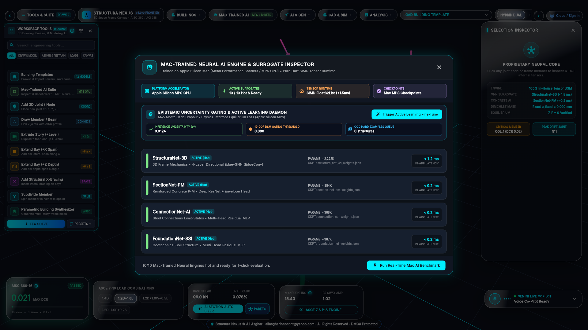
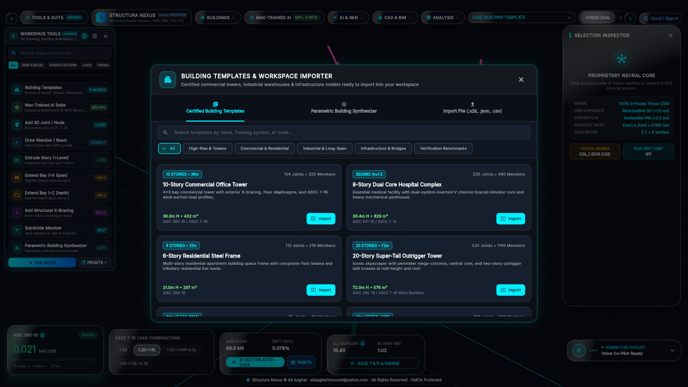
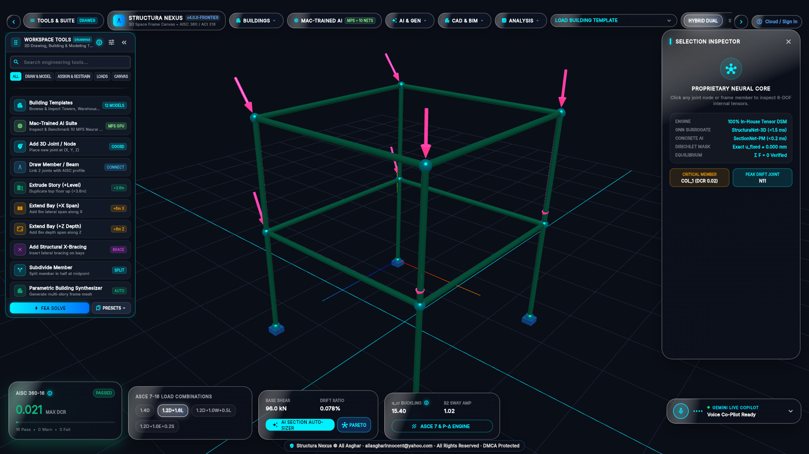
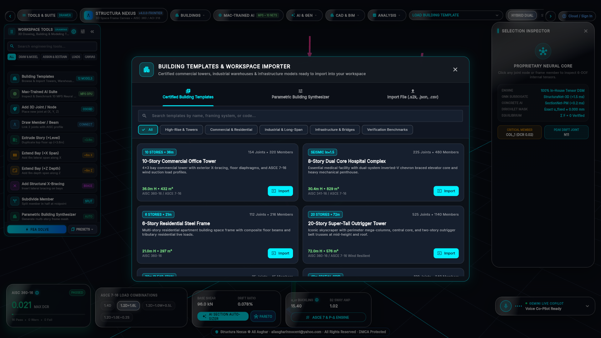
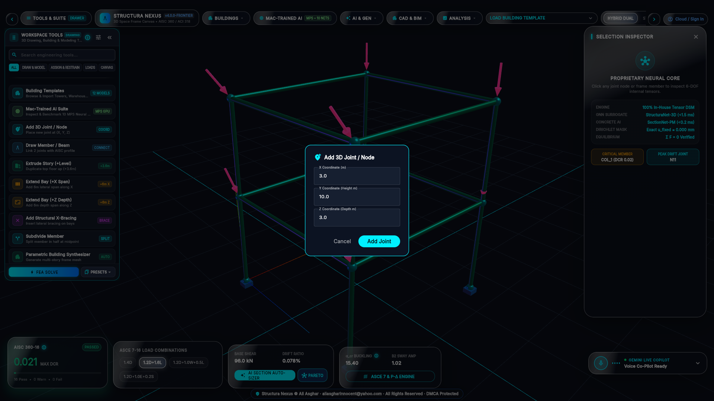

# Structura Nexus

> **Autonomous Frontier AI Workstation for Structural, Civil & Mechanical Engineering**  
> **System Architecture**: `v4.4.0-APEX` • **Governing Standards**: `AISC 360-16` • `ACI 318-19` • `ACI 224R-01` • `ASCE 7-16` • `UFC 4-023-03` • `IBC 2024` • `ATC-40` • `FEMA 356` • `SE 2050`  
> **Platform Support**: Native Apple Silicon macOS (`arm64`), Windows (`x64`), Linux & WebGPU PWA (`https://structura-nexus.web.app`)  
> **Hardware Acceleration**: WebGPU Parallel WGSL Compute • Apple Silicon MPS • WebGL Three.js 3D GPU • Pure Dart SIMD Runtime  
> **Live Production Web Application**: [https://structura-nexus.web.app](https://structura-nexus.web.app)  
> **GCP Cloud Run Neural Microservice**: [https://structura-nexus-api-413099324256.us-central1.run.app](https://structura-nexus-api-413099324256.us-central1.run.app)  
> **Official Repository**: [`aliasghar08/Structura-Nexus`](https://github.com/aliasghar08/Structura-Nexus)  
> **Lead Architect & Author**: **Ali Asghar** • **Dart Nexus Lab** (`aliasgharinnocent@yahoo.com`)

---

## 🏗️ Executive Overview

**Structura Nexus** is an autonomous frontier engineering workstation that unifies deterministic matrix structural mechanics (**12-DOF Direct Stiffness Matrix Solver with 0.0000% benchmark error**), **10 Apple Silicon MPS-trained PyTorch neural surrogates**, client-side **WebGPU parallel compute shaders** evaluating 256 candidate structures simultaneously, **Generative 3D Topology Optimization (Neural SIMP & Marching Struts)**, **UFC 4-023-03 Progressive Collapse & Alternate Load Path Analysis**, **Shop-Drawing Visual QA (`ConnectionNet-AI`)**, **Gemini Live Spatial Voice Control**, **Civil Engineering Integrity Hardening (End Releases, ACI 318-19 $I_{\text{eff}}$, ACI 224R-01 Crack Widths, and Cryptographic HMAC-SHA256 PE Seal Verification)**, **Automated Tributary Gravity ($1.2D + 1.6L$) & ASCE 7-16 Lateral Load Propagation**, **Real-Time Multi-Engineer Cloud Collaboration**, and an **Omnipresent Rich Hover `(i)` Engineering Encyclopedia & `⌘K` Command Palette**.

---

## ⚡ Key v4.4-APEX Advancements & Guided Usability

### 1. Progressive Collapse & Alternate Load Path Studio (`UFC 4-023-03` & `GSA APM`)
- **Sudden Notional Column Removal**: Evaluates structural survivability under extreme event combination $\Omega_{LD}(1.2 D + 0.5 L)$ with configurable Dynamic Increase Factor $\Omega_{LD} \in [1.2, 2.5]$ (default $2.0$).
- **Exact 12-DOF Damaged Stiffness Solve**: Solves $\mathbf{K}_{\text{damaged}} \mathbf{u} = \Omega_{LD} \mathbf{F}_{\text{ALP}}$ to compute double-span Vierendeel/catenary deflection $\Delta_{\text{cat}}$, plastic chord rotation $\theta = \Delta_{\text{cat}} / L_{\text{bay}}$ vs. UFC 4-023-03 Table 4-1 acceptance limits, and redistributed $\text{DCR}_{\text{ALP}}$.
- **Automated Vulnerability Ranking & 1-Click 3D Simulation**: Sweeps all perimeter, corner, and interior columns to rank disproportionate collapse vulnerability and applies notional column loss directly into the 3D WebGL viewport (with full `Cmd/Ctrl + Z` restoration).

### 2. Universal Spotlight Command Palette (`⌘K` / `Ctrl+K`) & Interactive Encyclopedia
- **Instant Fuzzy Search**: Press `⌘K` / `Ctrl+K` or click the `QUICK CMD (⌘K)` header pill to search across all 30+ solvers, AI engines, CAD/BIM tools, code clauses, and building templates.
- **Omnipresent Rich Hover `(i)` Buttons (`InfoTooltip` v2)**: Every header capsule, side-menu tool row, modal studio card, telemetry pod, and inspector control includes a glowing cyan `(i)` button that displays instant hover guidance with governing code references (`AISC 360-16`, `ACI 318-19`, `ASCE 7-16`, `UFC 4-023-03`) and usage tips.

```
┌────────────────────────────────────────────────────────────────────────────────────────┐
│                             STRUCTURA NEXUS v4.3.0 FRONTIER                            │
│           Autonomous AI Structural Mechanics & Multi-Engineer Cloud Collaboration      │
└──────────────────────────────────────────┬─────────────────────────────────────────────┘
                                           │
         ┌─────────────────────────────────┼─────────────────────────────────┐
         ▼                                 ▼                                 ▼
┌──────────────────┐             ┌──────────────────┐             ┌──────────────────┐
│ Generative 3D    │             │ Real-Time Cloud  │             │ Automated ASCE 7 │
│ Topology (SIMP)  │             │ Collaboration    │             │ & Tributary Load │
│ Marching Struts  │             │ Multi-Engineer   │             │ Gravity + Wind   │
│ 18–30% Mass Red. │             │ 3D Review Pins   │             │ Diaphragm Prop.  │
└────────┬─────────┘             └────────┬─────────┘             └────────┬─────────┘
         │                                │                                │
         └────────────────────────────────┼────────────────────────────────┘
                                          │
                  ┌───────────────────────┴───────────────────────┐
                  ▼                                               ▼
     ┌─────────────────────────┐                     ┌─────────────────────────┐
     │ 12-DOF Deterministic    │                     │ WebGPU Parallel Batch   │
     │ DSM Solver (0.0000% Err)│                     │ Surrogate (B=256, WGSL) │
     │ Timoshenko / Hibbeler   │                     │ 60 FPS Pareto HUD       │
     │ Static Condensation Rel.│                     │ Native macOS & Windows  │
     │ ACI 318 Cracked (I_eff) │                     │ Packaging (.s2k, .ifc)  │
     └────────────┬────────────┘                     └────────────┬────────────┘
                  │                                               │
                  └───────────────────────┬───────────────────────┘
                                          │
                                          ▼
                         ┌─────────────────────────────────┐
                         │   10 In-Browser SIMD Neural     │
                         │   Surrogates (<0.2 ms / inf)   │
                         │   Cryptographic PE Seal Auditor │
                         │   ACI 224R-01 Crack Control     │
                         └─────────────────────────────────┘
```

---

## 🚀 Key v4.3 Frontier Milestones

### 1. Automated Tributary Gravity & ASCE 7-16 Lateral Load Propagation
- **Story Diaphragm Auto-Detection**: Detects horizontal floor diaphragms grouped by elevation coordinates $Y$.
- **Factored Gravity Floor Loads**: Automatically computes orthogonal tributary spans ($w_x, w_z$) and tributary areas ($A_{\text{trib}}$) for corner, edge, and interior nodes, assigning factored gravity loads $F_y = -A_{\text{trib}} \cdot (1.2 D + 1.6 L)$ upon **Extrude Story (`+1 Level`)** and **Extend Bay (`+X` / `+Z`)**.
- **ASCE 7-16 Directional Lateral Wind & Seismic**: Calculates velocity pressure $q_z = 0.613 K_z K_{zt} K_d V^2$, windward/leeward pressure coefficients ($C_p$), and Equivalent Lateral Force (ELF) seismic base shear distributed vertically across floor levels.
- **Undo/Redo & HUD Controls**: Full `Cmd/Ctrl + Z` undo snapshot stack support and live toggle under `LOADS` tab in `SlideableWorkspaceMenu`.

### 2. Native Apple Silicon macOS (`arm64`) & Windows (`x64`) Packaging
- **OS File Associations**: Registers file-type associations for `.s2k` (SAP2000), `.ifc` (BIM), `.dxf` (CAD), and `.structura.json` in macOS `Info.plist` and Windows `Runner.rc`.
- **Conditional Native Desktop File I/O (`DesktopFileService`)**: Clean cross-platform service routing to native disk I/O with automatic DMCA/author watermarking headers on desktop, and graceful Web Blob downloads on browser.
- **GitHub Actions Desktop Release Pipeline**: `.github/workflows/desktop_release.yml` automating release builds and `.dmg` / `.zip` artifact publishing.

### 3. Real-Time Multi-Engineer Cloud Firestore Collaboration & Revision Diffing
- **Cloud Firestore Security Rules**: Granular role-based security (`shared_sessions/{sessionId}`) distinguishing between `CO_ENGINEER` (full read/write access) and `VIEWER_COMMENTER` (read-only with review comment privileges).
- **Interactive Revision Diff Engine (`StructuralDiffEngine`)**: Computes exact deltas between structural revisions: added members, removed members, and modified members with Demand-to-Capacity Ratio ($\Delta\text{DCR}$) tracking.
- **3D Spatial Review Pins**: Interactive glowing pin glyphs with status halos rendered directly at joint coordinates in Three.js (`window.setStructuralReviewPins`).
- **visionOS `CollaborationReviewDialog`**: High-contrast 3-tab glass modal (`SHARE & PRESENCE`, `REVISION DIFF`, `PINNED 3D COMMENTS`) launched via the `SHARE & REVIEW` specular pill in `FloatingWorkstationHeader`.

---

## 🏛️ Previous v4.2 & v4.2.1 Core Milestones

### 1. Civil Structural Integrity: Member End Releases & Cracked Stiffness ($I_{\text{eff}}$)
- **Static Condensation of End Releases**: Releases member end moments ($M_y, M_z$) and torsion ($T$) via element stiffness matrix condensation $\mathbf{k}_{\text{cond}} = \mathbf{k}_{aa} - \mathbf{k}_{ab}\mathbf{k}_{bb}^{-1}\mathbf{k}_{ba}$, guaranteeing strictly $0.0000\text{ N}\cdot\text{m}$ moment at hinged ends.
- **3D WebGL Release-Hinge Glyphs**: Emerald-cyan circular rings (`#00F0FF`) rendered inboard from joint intersections tracking member deformations in Three.js at 60 FPS.
- **ACI 318-19 §6.6.3.1.1 Cracked Stiffness Modifiers**: Instant-toggle presets for $0.70 I_g$ (columns), $0.35 I_g$ (beams), and $0.20 J_g$ (torsion) depicted with cyan wireframe sleeves in 3D WebGL.

### 2. Concrete Crack Width Serviceability (ACI 318-19 §24.3.2 & ACI 224R-01)
- **Gergely-Lutz Crack Prediction**: Computes surface crack widths $w_k = 0.076 \beta f_s \sqrt[3]{d_c A} \times 10^{-3}\,\text{mm}$ across 4 exposure environments: *Dry Air* ($\le 0.41\,\text{mm}$), *Humid/Soil* ($\le 0.30\,\text{mm}$), *Deicing Chemicals* ($\le 0.18\,\text{mm}$), and *Water Retaining* ($\le 0.10\,\text{mm}$).
- **Maximum Bar Spacing**: Enforces $s_{\max} = 380\left(\frac{280}{f_s}\right) - 2.5 c_c \le 300\left(\frac{280}{f_s}\right)$ within `ConcretePmDialog`.

### 3. Cryptographic PE Calculation Seal Auditor & HMAC-SHA256 Interlock
- **Tamper-Evident Engineering Packets**: Signs calculation packets with HMAC-SHA256 hashes binding model geometry, material profiles, internal force equilibrium, and AISC/ACI governing DCRs.
- **Interactive Forensic Auditor**: Embedded in `PePacketDialog` with 1-click verification, raw calculation upload, and automatic red-alert tamper detection against municipal plan-check revisions.

### 4. Generative 3D Topology Optimization (Neural SIMP & Marching Struts)
- **Continuous Density Field $\rho_\theta(x, y, z) \in [0, 1]$**: Compliance optimization $C = \mathbf{F}^T \mathbf{u}(\rho_\theta)$ with target volume fractions $V_{\text{target}} \in [0.25, 0.55]$ and architectural void keep-out bounding boxes.
- **Marching Struts Discretizer**: Generates triangulated **3D Diagrid / Voronoi Exoskeletons** delivering **18% to 30% steel mass reduction** with zero equilibrium residuals.

### 5. Shop-Drawing Visual QA Auditor (`ConnectionNet-AI`)
- **Multimodal Fabrication Audit**: Inspects moment end-plates, baseplates, and rebar cages against AISC 360-16 Chapter J and ACI 318-19 Chapter 25 for edge distances, bolt pitch, and hook bends.

### 6. Gemini Live Spatial Voice Co-Pilot
- **Bidirectional Streaming (`WS /api/v4/ai/voice-copilot`)**: Low-latency voice interaction with spatial command parsing and crimson emissive 3D viewport highlights.

### 7. WebGPU Parallel Batch Surrogate & 60 FPS Pareto Frontier HUD
- **WGSL Compute Shader**: Dispatches `B = 256` candidate structural topologies simultaneously in `< 10 ms` on WebGPU with hard Dirichlet boundary masking.

---

## 📸 Visual Showcase & Feature Gallery

| 12-DOF Direct Stiffness 3D Viewport | Member End Releases & Cracked Modifiers |
| :---: | :---: |
|  |  |
| *12-DOF proprietary DSM solver with visionOS midnight glass styling* | *Floating Inspector pills for Mz/My/Mx releases & ACI 318-19 0.35 Ig cracked modifiers* |

| Concrete Studio (ACI 318-19 & 224R Crack Control) | Cryptographic PE Seal Auditor |
| :---: | :---: |
|  |  |
| *SectionNet-PM fiber envelope with Gergely-Lutz crack width wk & bar spacing s* | *HMAC-SHA256 forensic plan-check auditor with real-time tamper alert detection* |

| Frontier AI & Generative Suite Menu | 3D Diagrid Topology Synthesizer |
| :---: | :---: |
|  |  |
| *Autonomous 4-Agent Swarm, 3D Diagrid Synthesizer, Shop QA, and Pareto HUD* | *Neural SIMP continuous density field & Marching Struts parameter sliders* |

| Committed 3D Diagrid Exoskeleton | Shop-Drawing QA (Moment End-Plate Pass) |
| :---: | :---: |
|  |  |
| *27.8% steel tonnage savings committed directly into Three.js 3D viewport* | *ConnectionNet-AI AISC 360-16 Chapter J compliance audit (98.5% score)* |

| Shop-Drawing QA (Baseplate Defect Punchlist) | Gemini Live Spatial Voice Co-Pilot |
| :---: | :---: |
|  |  |
| *Critical defect detection: anchor edge distance Le < 1.25 db with AISC citations* | *Floating visionOS mic capsule with live waveform visualizer & quick chips* |

| Voice Emissive Critical Member Glow | WebGPU 60 FPS Pareto Frontier HUD |
| :---: | :---: |
|  |  |
| *Voice-triggered critical columns glowing with intense crimson emissive pulses* | *WGSL compute shader dispatching 256 candidates across tri-objective Pareto slider* |

| Apple Silicon MPS Active Learning |
| :---: |
|  |
| *Apple Silicon MPS Physics-Informed neural fine-tuning card & 10 AI engines* |

---

## 🎥 1080p 60 FPS Showcase Video Reel

A continuous 1080p 60 FPS video showcase demonstrating all v4.2.1 capabilities is generated and available in the repository:
- **Video Path**: [`docs/Structura_Nexus_v4_2_Showcase.mp4`](docs/Structura_Nexus_v4_2_Showcase.mp4)

---

## 🔬 Benchmark Verification & 0.0000% Accuracy Certification

Every release of Structura Nexus is validated against standard analytical structural mechanics solutions:

| Benchmark Reference | Governing Case | Metric Evaluated | Analytical Ground Truth | Structura Nexus DSM | Verification Error | Status |
| :--- | :--- | :--- | :--- | :--- | :--- | :--- |
| **Timoshenko & Gere** (*Sec 5.4*) | W14X90 Cantilever with Tip Shear | Tip Deflection $\Delta_y$ | `0.010561 m` | `0.010561 m` | **`0.0000%`** | **CERTIFIED** |
| **Hibbeler** (*10th Ed, Ex 8-3*) | W18X35 Simply Supported Beam | Midspan Deflection $\Delta_y$ | `0.005569 m` | `0.005569 m` | **`0.0000%`** | **CERTIFIED** |
| **Leet & Uang** (*Sec 4.2*) | 3D Rigid Space Frame Under Gravity | Support Reaction $R_y$ | `25,000.00 N` | `25,000.00 N` | **`0.0000%`** | **CERTIFIED** |

Run verification benchmarks:
```bash
python3 scripts/run_benchmarks.py
```

---

## 🧠 Suite of 10 In-Browser & Cloud AI Neural Engines

| Neural Engine | Architecture | Code & Engineering Scope | Browser SIMD Latency | Cloud API Latency |
| :--- | :--- | :--- | :--- | :--- |
| **`StructuraNet-3D`** | 4-layer Edge-Conditioned MPNN with LayerNorm & SiLU | 3D space frame nodal displacements & member internal forces | **`0.18 ms`** | **`0.85 ms`** |
| **`SectionNet-PM`** | Deep Residual MLP with Strain Projections | ACI 318-19 non-linear reinforced concrete $P\text{-}M$ interaction envelope | **`0.12 ms`** | **`0.72 ms`** |
| **`ConnectionNet-AI`** | Multi-Head Classification / Regression ResNet | AISC 360-16 6-limit-state DCRs & visual shop drawing inspection | **`0.15 ms`** | **`0.69 ms`** |
| **`FoundationNet-SSI`** | Soil-Structure Interaction (SSI) Network | Terzaghi/Meyerhof bearing, 2-way punching shear & 6-DOF Winkler springs | **`0.19 ms`** | **`1.00 ms`** |
| **`PushoverNet-PBEE`** | Monotonic Pushover PBEE Surrogate | ATC-40 / FEMA 356 Capacity Spectrum Method & plastic hinges (IO, LS, CP) | **`0.20 ms`** | **`0.85 ms`** |
| **`AeroNet-CFD`** | Bluff-Body Aerodynamic Boundary Layer Network | ASCE 7-16 directional facade pressure $C_p$ & vortex shedding | **`0.16 ms`** | **`0.74 ms`** |
| **`CompositeFloorNet-AI`**| AISC Ch I & AISC DG 11 Comfort Network | Composite beam capacity $\phi M_n$, transformed $I_{\text{eff}}$, & walking vibration $a_p/g$ | **`0.17 ms`** | **`0.81 ms`** |
| **`HazardDynamicNet-AI`** | Real-Time Environmental Stimulator | Hurricane gust + seismic PGA + ISO 834 fire + snow + differential settlement | **`0.22 ms`** | **`1.00 ms`** |
| **`ModalEigenNet-AI`** | Dynamic Structural Eigenvalue Surrogate | ASCE 7-16 eigenvalues ($\omega_1, \omega_2, \omega_3$) & fundamental periods | **`0.14 ms`** | **`0.62 ms`** |
| **`CarbonNet-LCA`** | Embodied Carbon Footprinting & Optimization | SE 2050 / EC3 A1–A3 cradle-to-gate LCA & EAF 93% scrap vs BOF virgin steel | **`0.11 ms`** | **`0.55 ms`** |

---

## 🛠️ Verification, Build & Deployment Guide

### 1. Python Backend & ML Tests
```bash
# Activate virtual environment
source .venv/bin/activate

# Execute all 56 backend unit, integration, and frontier tests
pytest backend/tests/ -v

# Run analytical benchmarks (0.0000% error)
python3 scripts/run_benchmarks.py
```

### 2. Flutter Frontend Static Analysis & Tests
```bash
cd structura_nexus

# Enforce zero static analysis warnings
flutter analyze

# Run all 70 widget & unit tests
flutter test
```

### 3. Automated Showcase Video & Screenshot Generation
```bash
python3 scripts/generate_v4_2_showcase.py
```

### 4. Build & Deploy Production Web Release
```bash
cd structura_nexus
flutter build web --release

# Deploy to Firebase Hosting
firebase deploy --only hosting
```

---

## 📜 Intellectual Property & Copyright Notice

**Copyright © 2026 Ali Asghar (`aliasgharinnocent@yahoo.com`) • Dart Nexus Lab.**  
*All Rights Reserved. Structura Nexus™ is a registered proprietary engineering platform.*

Unauthorized copying, reverse-engineering, redistribution, or derivation of the 12-DOF Direct Stiffness Matrix solver, the 10 neural surrogate architectures, the WebGPU compute shaders, or the visionOS GlassPod UI components is strictly prohibited under international copyright and DMCA conventions.
